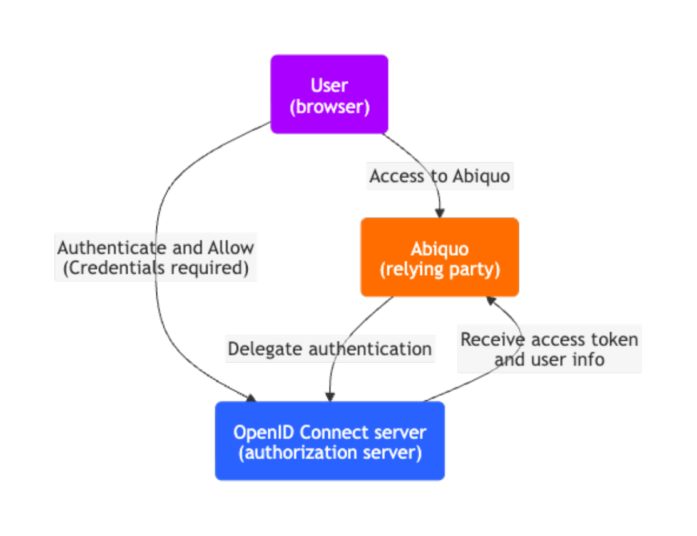

# About Abiquo OpenID Connect integration

## Introduction

This page describes the Abiquo OpenID integration with an OpenID Connect provider for SSO and federated authorization. For a step-by-step setup, see [Configure Abiquo OpenID integration](/configure_abiquo_openid_integration.md).

## Scope

Abiquo integrates with [OpenID Connect](https://openid.net/connect/) to let Abiquo leverage single sign-on authentication and federated authorization features.

The integration targets the [core spec](https://openid.net/specs/openid-connect-core-1_0.html), but also implements some optional features such as the  [*RP-Initiated-Logout*](https://openid.net/specs/openid-connect-session-1_0.html#RPLogout) from the optional Session Management spec.

The integration doesn't cover discovery, dynamic registration, or other optional features.

## Requirements

To configure the Abiquo OpenID integration,  you must have an OpenID Connect provider and admin access to the `abiquo.properties` configuration files.

## Basic workflow

In the OpenID basic workflow, the user interacts with Abiquo (the Application), which is also a client of the OpenID Connect server (the Identity Server).

The following diagram shows the basic authentication and authorization workflow when using the OpenID Connect integration.

[Flowchart Mermaid file](diagrams/openid_flowchart.md)

The authorization process is as follows:

1. Users access the Abiquo portal and it redirects them to the OpenID Connect server
2. Users enter their credentials to log in to the OpenID Connect server (the credentials are never exposed to Abiquo). It displays the consent screen that describes the permissions that Abiquo is requesting and the information it needs to access.
3. Upon successful authentication and consent grant, the OpenID Connect server issues the following tokens and redirects the user back to the app:
   1. **ID token** \- A JWT token containing the information about the user.  
   2. **Access token** \- An OAuth token that provides access to the app resources on behalf of the user.  
   3. **Refresh token** \- An optional token to refresh the access token when it expires.
4. Abiquo uses the access token to request information about the logged user (such as permissions) and creates the corresponding user in the Abiquo database.
5. Users access the Abiquo platform, including the Abiquo API, with the access token.

Notes:

* At any time, users with the refresh token can call the Abiquo API to refresh the access token.
* If you configure global logout, when users sign out from the Abiquo platform, it signs them out of the OpenID Connect server.

## ACR validation

In an OpenID Connect Integration, the authorization request can contain a list of authentication modes that the server should show to the user. This is a list of acr-values and it's a configuration of the OpenID Connect Server. You can configure Abiquo to request it using the acr-values system property.

Response tokens can contain the acr-values used by the user to authenticate. You can configure Abiquo to validate that these acr-values are the requested ones by setting the acr-validation system property. Abiquo will fail the authentication process if the tokens are not the requested ones.

## OpenID Connect authentication mode

When Abiquo is in normal authentication mode, Abiquo authenticates and obtains user authorization from the Abiquo database.  
In contrast, when the platform is in OpenID Connect mode, Abiquo authenticates and obtains user authorization from the OpenID Connect server. In OpenID mode, Abiquo behaves as follows:

* Abiquo creates an Abiquo OpenID user automatically under the following conditions:  
  * The user successfully authenticates through the OpenID Connect server;  
  * And Abiquo finds an Abiquo tenant and user role that matches the one specified through the OpenID user data.
* Every time a user logs in, Abiquo synchronizes that user's data with the OpenID Connect server. This overwrites any changes made directly to the Abiquo user account.  
  * A user that has switched enterprises returns to their assigned enterprise when they log in.
* Abiquo deactivates login for users with non-OpenID accounts.  
  * This includes the main cloud admin user.
* Abiquo deactivates features associated with normal authentication, such as Abiquo two-factor authentication, and Abiquo password reset.  
  * The OpenID Connect server should provide this type of feature when authenticating users.

## OpenID sequence diagram

The following sequence diagram shows how to use the different endpoints from a user and relying party perspective.
The diagram depicts the interactions between all parties involved in the OpenID Connect protocol.

[Sequence diagram Mermaid file](diagrams/openid_sequence_diagram.md)
