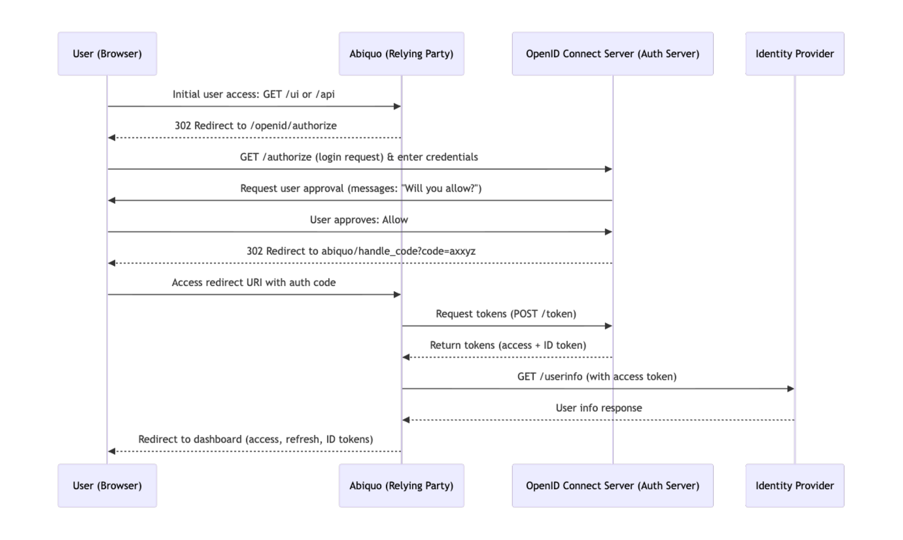

# Configure Abiquo OpenID Connect integration

## Introduction

 This page is a reference for systems administrators integrating Abiquo with an OpenID Connect provider for SSO and federated authorization. For a full description of the integration, see [About Abiquo OpenID Integration](/about_abiquo_openid_integration.md)

## Requirements

This configuration requires an OpenID Connect provider and admin access to the `abiquo.properties` configuration files.

## OpenID Connect configuration steps

This is an overview of the steps to configure the OpenID Connect Integration.

1. Configure the cloud admin user with Abiquo in normal authentication mode.
2. Map OpenID users to Abiquo enterprises and roles while Abiquo is in normal authentication mode.
3. Register Abiquo as a client application on the OpenID Connect server, and obtain the OpenID client credentials.
4. Configure the OpenID Connect server in `abiquo.properties`.  
5. Register the Abiquo Outbound API as an OAuth application and configure `abiquo.properties`. For this step, you can download a tool from the Abiquo Support Portal.
6. Configure the OpenID Connect logout.
7. Configure Abiquo UI properties.
8. Start the Abiquo Server.
9. Configure API and Outbound API clients to work with an access token.

## Configure cloud admin user

Configure cloud admin user with Abiquo in normal authentication mode.  
Remember that Abiquo deactivates this user when you enable OpenID Connect authentication mode.

## Map OpenID Connect users to Abiquo enterprises and roles

In OpenID Connect authentication mode, when a user successfully authenticates through the OpenID Connect server, Abiquo receives OpenID user data. Abiquo tries to match the user data to the following in Abiquo:

* A user role such as cloud admin, tenant admin, cloud user  
* An enterprise (cloud tenant) that the user belongs to

To enable Abiquo to match the user, you must work in Abiquo to **map** the Abiquo enterprise and role to the OpenID user data. Work in normal authentication mode as cloud admin user. If Abiquo can't find the role and enterprise, it won't create the OpenID user.

### How Abiquo determines which role to assign to an OpenID user

The OpenID Connect server returns user data, including a list of the external roles/permissions for the user, which is a role claim. Abiquo identifies the role claim in the OpenID user data using the name you configure with the `abiquo.openid.role-claim` property. Abiquo searches for an existing Abiquo role with the same LDAP attribute data as the role claim.

### Map external roles to Abiquo roles

To map OpenID roles to an Abiquo role:

1. Create, clone or edit an Abiquo role  
2. In the External Roles field, enter the same list of external roles/permissions as the OpenID user's role claim

Remember that a user's external roles must map to one local role in their enterprise and/or one global role.

### How Abiquo determines which enterprise an OpenID user should belong to

The OpenID Connect server returns user data, including the tenant that a user should belong to, which is an enterprise claim. Abiquo can look up this enterprise in Abiquo by enterprise name or by enterprise property.  
If Abiquo can't find the enterprise, it won't let the user log in. If the user account doesn't exist, Abiquo creates it in the enterprise. If the user account exists in another enterprise, Abiquo moves it to the one assigned by the OpenID Connect server.

Abiquo obtains the enterprise claim defined by the `abiquo.openid.enterprise-claim` property.  
Abiquo matches the enterprise claim to the enterprise name if the `abiquo.openid.enterprise-property` property isn't set in `abiquo.properties`.  
Otherwise, it matches the value of the enterprise claim to the value of the enterprise property specified by the `abiquo.openid.enterprise-property` property.

### Map external enterprises to Abiquo enterprises

Map external enterprises to Abiquo enterprises according to the lookup method you configured for your platform.

To map an OpenID enterprise to an Abiquo enterprise by **enterprise name**, set the name of the enterprise to the value in the enterprise claim.

To map an OpenID enterprise to an Abiquo enterprise by **enterprise property**:

1. Create or edit an Abiquo enterprise  
2. Create an enterprise property with the key configured in the `abiquo.openid.enterprise-property` in `abiquo.properties`. For example, for `abiquo.openid.enterprise-property = domain`, create an enterprise property called `domain`  
3. Set the value of this property to the value of the enterprise claim for this tenant

When the authorization server returns the enterprise claim, Abiquo looks for all enterprises with a `domain` property. It finds the one with the value that matches the value returned by the OpenID Connect server. In the example, when the OpenID Connect server returns the value `http://abiquo.com` in the enterprise claim, Abiquo selects the enterprise.

## Register Abiquo as a client app in the OpenID Connect server

Register Abiquo as a client app in the OpenID system and obtain the client credentials: `client name`, `client id` and `client secret`. Configure these in `abiquo.properties` in the next step.

## Configure Abiquo properties

To configure OpenID Connect in `abiquo.properties`:

1. Configure OpenID Connect server details including endpoints and claims
2. Configure OpenID client credentials from the previous step of registering Abiquo as a client application
3. Activate OpenID in `abiquo.properties`, by setting `abiquo.auth.module` to `openid`

If your OpenID Connect provider implements the [Discovery](https://openid.net/specs/openid-connect-discovery-1_0.html) extension, you may be able to get the value of the different endpoints. To do this, go to the well-known configuration endpoint, as described in the [provider configuration](https://openid.net/specs/openid-connect-discovery-1_0.html#ProviderConfig) section.

## OpenID sequence diagram

The following sequence diagram shows how to use the different endpoints from a user and relying party perspective.
The diagram depicts the interactions between all parties involved in the OpenID Connect protocol.



[Sequence diagram Mermaid file](diagrams/openid_sequence_diagram.md)

### Configure Abiquo OpenID Connect properties

To enable the OpenID Connect mode, configure the following properties in Abiquo:

```text
abiquo.auth.module=openid
abiquo.openid.cookie.maxage=30
abiquo.openid.cookie.refreshtoken.include=false
abiquo.openid.target=https://<abiquo ui host>/ui/#/dashboard
abiquo.openid.role-claim=https://claims.idp.mycompany.com/role
abiquo.openid.enterprise-claim=https://claims.idp.mycompany.com/department
abiquo.openid.enterprise-property=enterprise_claim
abiquo.openid.issuer=
abiquo.openid.authorization.endpoint=
abiquo.openid.token.endpoint=
abiquo.openid.userinfo.endpoint=
abiquo.openid.jwks.endpoint=
abiquo.openid.endsession.endpoint=
OpenID Connect client configuration** | |
abiquo.openid.client.name=
abiquo.openid.client.id=
abiquo.openid.client.secret=
abiquo.openid.client.scopes=openid,profile,email,phone
abiquo.openid.client.redirect-uris=http://<api endpoint>/api/openid_connect_login
abiquo.openid.client.acr-values=
abiquo.openid.client.acr-validation=
```

For full details of the properties, see [Reference Abiquo OpenID integration](/reference_abiquo_openid_integration.md)

## Configure Abiquo outbound API module

When you run Abiquo in OpenID Connect mode, you must configure the Outbound API to use OAuth tokens.

Register the Outbound API as an OAuth app (for Outbound API user or admin user). You download an Abiquo tool from the Abiquo Support portal to obtain the OAuth access tokens. Configure credentials in `abiquo.properties` and remove any old credentials properties.

Here are the full configuration steps.

1. Create a new app for the  "default api outbound user"  as explained in the  "Manage OAuth Applications"  guide, and set all the privileges for that user; OR  
   Create the app in the administrator account, and select only the permissions for the  "default api outbound user".
2. Get the OAuth access tokens. You can use an Abiquo tool to obtain the access tokens.  
   Download the tool from the Abiquo Support portal.  
3. In the `abiquo.properties` file of the Abiquo Server  
   1. Configure the following OAuth properties  
      1. `abiquo.m.consumerKey`  
      2. `abiquo.m.consumerSecret`  
      3. `abiquo.m.accessToken`  
      4. `abiquo.m.accessTokenSecret`  
   2. **And remove** the following properties  
      1. `abiquo.m.identity`  
      2. `abiquo.m.credential`

## Configure OpenID Connect logout

If the OpenID Connect server implements the [Session Management](https://openid.net/specs/openid-connect-session-1_0.html) extension, you can configure the Abiquo platform to issue a logout to the OpenID Connect server when the user logs out from the platform.  
This is optional because users may not want to log out from all services when logging out from Abiquo.

To enable the global logout, configure the `abiquo.openid.endsession.endpoint` property to point to the end session endpoint, as defined by the [RP-Initiated Logout](http://openid.net/specs/openid-connect-session-1_0.html#RPLogout) spec.

## Configure OpenID Connect client UI properties

Configure the following OpenID Connect client UI properties in the `client-config-custom.json` file.

```json
"client.skip.login.view":false,
"client.auth.module":"openid"
```

For full details, see [Reference Abiquo OpenID integration](/reference_abiquo_openid_integration.md)

## Start the Abiquo server

Start the Abiquo server and log in to the Abiquo UI with your admin user. Check that your user is properly redirected to the OpenID Connect login page, and that you can correctly access the full Abiquo dashboard. Confirm that logging in with a test user of each mapped role succeeds and opens the correct enterprise. Check that you cannot log in with test users that should not have access under OpenID Connect.

## Configure API and outbound clients

In OpenID Connect mode, Abiquo deactivates Basic Authentication, so use an access token to authenticate with the API or the Outbound API endpoint.

Abiquo still supports authentication using the session cookie or Abiquo OAuth applications as before.

To obtain an access token:

1. Manually log in to the Abiquo UI
2. When you are redirected to the Abiquo console, the access token and refresh token are in the URI.

Using the token, you can issue requests to the API by providing the following HTTP header: `Authorization: Bearer <ACCESS_TOKEN>`. For example:

```bash
  ▎ curl -X GET "http://<abiquo-api-host>/api/cloud/virtualdatacenters" \
  ▎   -H "Authorization: Bearer <ACCESS_TOKEN>"
```

## Optional SameSite cookie flag configuration

On the Abiquo Server, optionally set the `abiquo.login.samesite` property to control the value of the `SameSite` flag of the login cookie. See [Abiquo Configuration Properties#samesite](https://wiki.abiquo.com/display/doc/Abiquo+Configuration+Properties#AbiquoConfigurationProperties-samesite).

## Refreshing access tokens

Access tokens have an expiration, so at some time they stop working. When this happens, the user can use a refresh token to request a new access token, if the refresh token was returned during authentication. Refresh tokens also expire, but have a significantly longer life time: the default is 1 week.

Some OpenID Connect providers issue new refresh tokens every time you refresh an access token. In this case, you can use the refresh mechanism without limits.

To request a new access token using a refresh token, send an HTTP request to the `openid_connect_refresh` Abiquo API endpoint, passing the refresh token as a query parameter:

```curl
curl -v "http://<abiquo-api-host>/api/openid_connect_refresh?refresh_token=<REFRESH_TOKEN>" \
    -H "Accept: application/vnd.abiquo.oidctokens+json"

  {
     "scope" : "openid profile email abiquo",
     "id_token" : "<ID_TOKEN>",
     "refresh_token" : "<REFRESH_TOKEN>",
     "token_type" : "Bearer",
     "links" : [],
     "expires_in" : 3599,
     "access_token" : "<ACCESS_TOKEN>"
  }
```

The refresh token is meant to be used when the access token is expired. So the Abiquo API passes the refresh token to the authorization server and lets it verify the validity of the token and the identity associated with it.

## Troubleshooting

The OpenID login process can return an error message, for example, due to a delayed login or timeout.  
To prevent this, for Internet Explorer cookies, in `server.xml` on Abiquo Tomcat, the `<Host>` section should contain an `<Alias>` section with the domain of the web server (where users access the UI).  
Abiquo has changed the default Java session timeout to 30 minutes to ensure user delays during OpenID login won't result in further errors.

## Change log for Abiquo OpenID integration

### Changes in Abiquo 5.1.2

This version introduced a new Abiquo configuration property

* `abiquo.login.samesite`

### Changes in Abiquo 4.6

This version introduced two new Abiquo configuration properties

* `abiquo.openid.cookie.maxage`  
* `abiquo.openid.cookie.refreshtoken.include`

### Changes in Abiquo 3.10.7 and 4.0.4

* To retrieve the user's phone number from the OpenID system, add `phone` to the value list of the `abiquo.openid.client.scopes` property. Abiquo doesn't validate the phone number.
